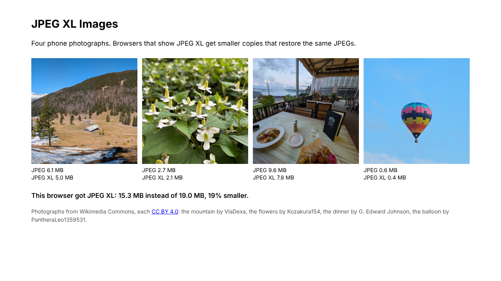

[](https://deploy.workers.cloudflare.com/?url=https://github.com/cloudflare/templates/tree/main/jpeg-xl-template)

# JPEG XL Images

<!-- dash-content-start -->

Serve your site's photographs as JPEG XL to the browsers that accept it, and as the original JPEG or PNG to the rest.

A Worker sits in front of the site's [static assets](https://developers.cloudflare.com/workers/static-assets/). When a browser sends `Accept: image/jxl`, the Worker answers a picture's address with a JPEG XL copy. Every other browser gets the file you uploaded, unchanged.

The copies are made once, when the site is built. JPEGs are recompressed without loss and restore to the same bytes. PNGs are encoded with every pixel kept. The Worker reads no picture and encodes nothing, so each request costs almost no CPU and the template runs on the Workers Free plan.

The encoder is [rapier-jxl](https://www.npmjs.com/package/jpegxl), which runs in WebAssembly with no native dependencies.

### Features

- JPEG XL to browsers that accept it, the original to the rest
- Copies made at build time, so the Worker only chooses and sends
- JPEGs stay lossless and restore to the same bytes
- Runs on the Workers Free plan
- `Vary: Accept` on every picture, so caches keep both answers apart

<!-- dash-content-end -->



A live public deployment of this template is available at [https://jpeg-xl-template.templates.workers.dev](https://jpeg-xl-template.templates.workers.dev).

## Getting Started

Create a project from this template:

```sh
npm create cloudflare@latest -- --template=cloudflare/templates/jpeg-xl-template
```

Put your pictures in `public/`.

### Develop

```sh
npm install
npm run dev
```

`npm run dev` builds the JPEG XL copies, then starts the site at http://localhost:8787. Open it and the page shows what your browser was sent.

### Deploy

```sh
npm run deploy
```

### Test

```sh
npm test
```

## How it works

- `public/` holds the site. `scripts/build.mjs` copies it to `dist/` and writes a JPEG XL copy beside each picture, so `photo.jpg` gets `photo.jpg.jxl`. Each JPEG copy is checked to restore the same JPEG before it is kept. A copy that is not smaller is not kept.
- `wrangler.jsonc` runs that build before `dev` and `deploy`, and lists the picture paths under `run_worker_first`. The Worker runs only for those. Every other file is served straight from the assets.
- `src/index.ts` reads the `Accept` header. For a browser that accepts JPEG XL it fetches the `.jxl` copy from the assets and sends it as `image/jxl`. With no copy, or for any other browser, it sends the original. It adds `Vary: Accept` to both.

### Settings

- `JXL_EFFORT` (1 to 9, default 7) is read by the build. Higher is smaller and slower.
- To add a picture, drop it in `public/` and deploy. The build converts only what changed.

## Learn more

- [Static assets](https://developers.cloudflare.com/workers/static-assets/)
- [`run_worker_first`](https://developers.cloudflare.com/workers/static-assets/routing/worker-script/)
- [JPEG XL](https://jpegxl.info/)
